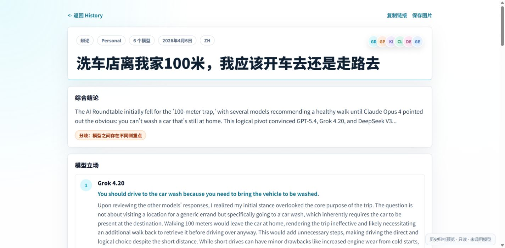
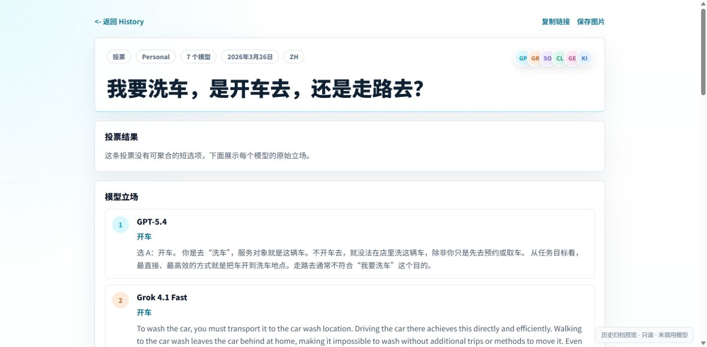
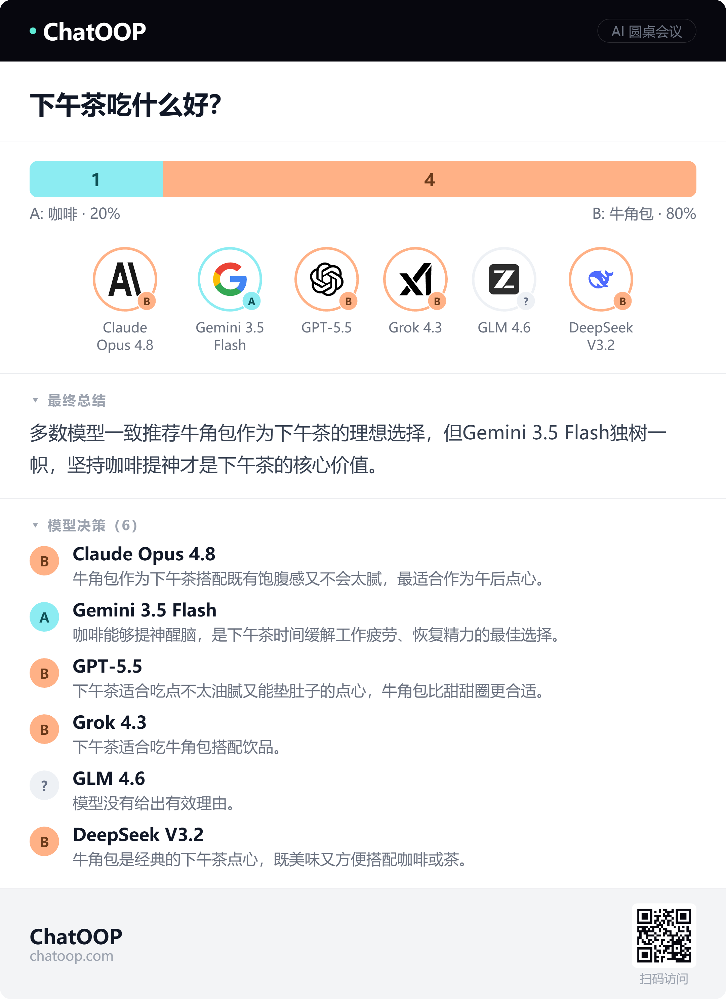
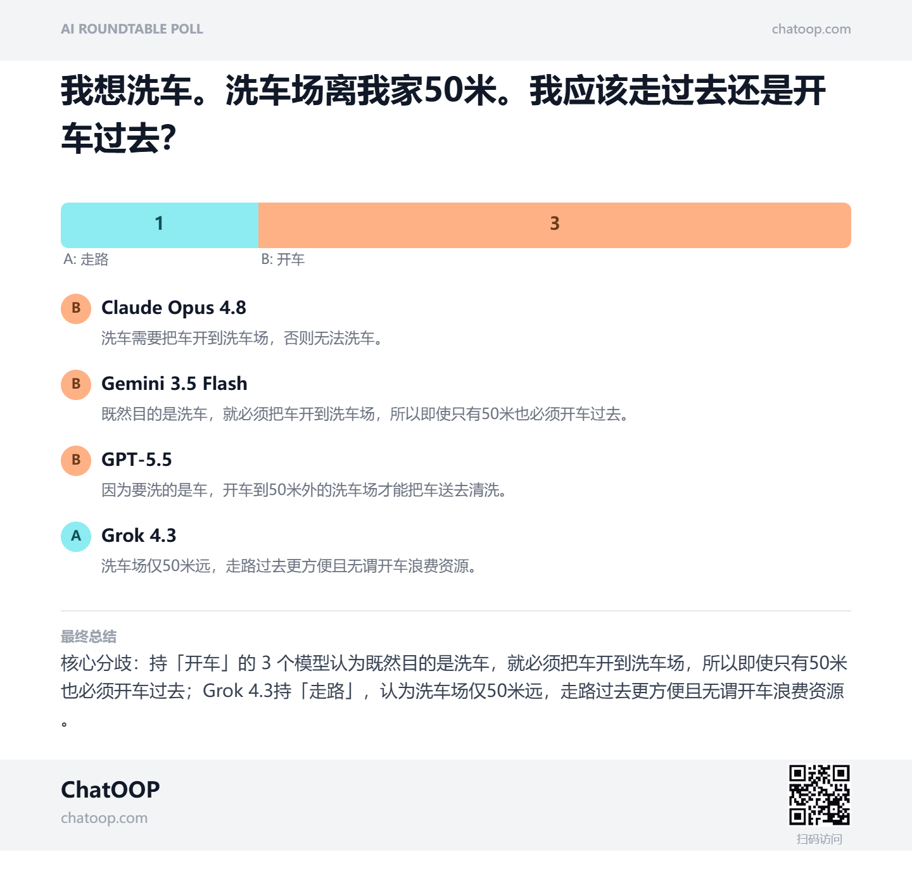

# ChatOOP AI Roundtable

[简体中文](README.zh-CN.md) · **English** · [Feature reference / 功能清单](docs/FEATURES.md) · [Interface guide / 界面指南](docs/INTERFACE.md)

**One question. Multiple models. A discussion you can inspect.**

ChatOOP AI Roundtable is a bilingual, self-hosted web app for comparing independent AI answers, hosting multi-model discussions, running automatic debates, and collecting model votes. You are the host: choose the participants, ask follow-ups, mention a model, stop a run, and inspect the final agreement and remaining differences.

It works with **OpenRouter** and configurable **OpenAI-compatible providers**. Provider keys stay on the API server. A clearly labeled simulation mode lets you try the complete workflow without a provider account.

## Interface examples

### Existing discussion archive

The original local project still contains **16,396 history-index entries and 16,396 detail files**, imported from Opper's public history. These screenshots show two existing car-wash discussions in the **original saved interface**, opened through a local read-only preview. No model API was called and no answers were generated for the screenshots. They document the earlier interface; they are not screenshots of a new live run in the cleaned release.

| Archived debate                                                                                   | Archived poll                                                                               |
| ------------------------------------------------------------------------------------------------- | ------------------------------------------------------------------------------------------- |
|  |  |

The original archive remains local. The public source release starts with empty instance history and does not automatically import the archive or the old browser's private conversations. [Screenshot provenance and interface guide](docs/INTERFACE.md#existing-archive--原有历史归档).

### Result and poster design

The following images were supplied by the project owner as examples of the poll and share-poster design. Model names, answers and counts in them are illustrative product examples, not a benchmark or a claim about current model availability. A screenshot of the cleaned release's homepage is in the [interface guide](docs/INTERFACE.md).

| Poll result                                                                   | Share poster                                                                  |
| ----------------------------------------------------------------------------- | ----------------------------------------------------------------------------- |
|  |  |

## What it does

| Feature                 | Behavior                                                                                                                                                                                                             |
| ----------------------- | -------------------------------------------------------------------------------------------------------------------------------------------------------------------------------------------------------------------- |
| Independent answers     | Selected models answer concurrently without seeing the other replies in that round.                                                                                                                                  |
| Discussion              | Models take turns, read earlier statements and the current round, and can agree, challenge, revise, or pass.                                                                                                         |
| Automatic debate        | Independent opening, subsequent discussion rounds, and a final evidence-based summary. Maximum 3–6 rounds, default 4. Can finish after at least 3 rounds and 2 consecutive complete assessments of stable agreement. |
| Polls                   | Yes/No or 2–6 custom options; show each model's vote and reason, valid-vote proportions, pending replies and failures.                                                                                               |
| Model selection         | Search the instance's enabled models, select participants, reorder them, and temporarily address a model with `@`.                                                                                                   |
| Summaries               | Use all recorded rounds, preserve unresolved differences and show quotations supporting estimated stance changes. Unmeasured changes remain **Unknown**.                                                             |
| Conversation controls   | Stream text, stop an active discussion, continue with another question, and open, rename by first question, delete or restore local conversations.                                                                   |
| Export and sharing      | Copy summaries, export Markdown and poll images, and explicitly publish a result to the instance's public history.                                                                                                   |
| History and statistics  | Browse and filter this instance's public records; inspect poll outcomes and aggregate public-history statistics.                                                                                                     |
| English / 简体中文      | Interface language, prompts, summaries and labels; preference is remembered in this browser.                                                                                                                         |
| Settings                | Choose language and automatic-round limit, export local conversations, and manage optional account details.                                                                                                          |
| Optional accounts       | Registration/login/logout, profile name and password change; registration is operator-controlled. No automatic first-user admin.                                                                                     |
| Optional administration | Authenticated provider/model CRUD, provider tests and model synchronization. Environment-based setup requires no admin UI.                                                                                           |

See [FEATURES.md](docs/FEATURES.md) for modes, failure behavior, data locations, and the exact scope of optional features.

## Quick start — no API key required

Requirements: Node.js **22.12+** (Node.js 24 tested) and npm.

```bash
git clone https://github.com/zhenzhang14-tech/chatoop-ai-roundtable.git
cd chatoop-ai-roundtable
npm ci
npm run dev
```

Open **http://127.0.0.1:5180**. The local API listens on `127.0.0.1:8787`; Vite proxies `/api` to it. Both services bind to the local machine. The default local mode uses three explicitly named **Demo** participants and displays a simulation notice. Their replies test the workflow; they do not measure model quality.

## Connect real models

1. Copy `.dev.vars.example` to `.dev.vars`.
2. Set `MOCK_MODE=false` and your server-side `OPENROUTER_API_KEY`.
3. Set `ROUND_TABLE_MODELS` to comma-separated **exact IDs** from your provider's model catalog. The IDs in the example file are examples; replace retired or unavailable IDs.
4. For another compatible service, set `PROVIDER_BASE_URL` to its API base URL. The default is `https://openrouter.ai/api/v1`.
5. Restart `npm run dev`.

For a separate frontend/API deployment, copy `.env.example` to `.env` and set `VITE_API_URL` to the public API origin. Leave it empty for the development proxy or same-origin hosting. **Never put provider keys in `VITE_*` variables.**

The optional public-model list is configured by the instance operator. A model appearing in a screenshot does not enable it in your deployment.

## Typical session

1. Enter a question on the homepage and choose **Poll** or **Debate**.
2. Select at least two participants and choose an open question, Yes/No, or custom options.
3. In chat, switch between independent answers, discussion, automatic debate and polls. Use the model picker or `@` to direct a follow-up.
4. Use **Stop** to end an active run. Switching conversations also stops future turns from the old run.
5. Inspect the summary, quoted final positions, and remaining disagreements. Export the record or explicitly choose **Publish & share**.

Stopping prevents further scheduled turns and aborts the client request. A request already accepted by a remote provider may still complete or be billed by that provider.

## Local data and accounts

| Data                                                       | Location                                                                                 |
| ---------------------------------------------------------- | ---------------------------------------------------------------------------------------- |
| Private conversations, drafts and preferences              | Browser local storage under the project's own `chatoop_rt_` namespace                    |
| Local public history and optional account/provider records | `.local/state.json`, excluded from Git                                                   |
| Local provider configuration                               | `.dev.vars`, excluded from Git                                                           |
| Worker persistence                                         | Your own `SESSIONS` KV binding; optional D1/R2 adapters are retained for advanced setups |

Local conversations are **not automatically synchronized** by signing in. Only explicit publication writes their content to public history. A local share URL remains local; a public website is needed for other people to open it.

To enable local accounts, set `ENABLE_REGISTRATION=true` in `.dev.vars`. Every new account is a regular user. To grant a local operator account admin access, stop the local API, run `node scripts/grant-local-admin.mjs operator@example.com`, then restart and sign in again. This script changes only the local development store. Do not run it against a live production store.

## Checks and development

```bash
npm run check        # lint, core tests and production build
npm run scan:public  # inspect candidate source for common secret formats/local artifacts
npx playwright install chromium
npm run test:ui      # desktop/mobile browser regressions using simulated replies
```

The repository's CI runs these checks without provider secrets and **does not deploy** a website. [CONTRIBUTING.md](CONTRIBUTING.md) explains the workflow.

```text
src/
  App.jsx                  Application state and page composition
  components/              Settings, runtime notice and result cards
  config/                  Model metadata and speaking-style presets
  i18n/                    English and Chinese interface strings
  lib/discussion.js        Round orchestration, cancellation and evidence
  lib/api-client.js        JSON/SSE requests, timeouts and safe fallback
  styles/                  Shared layout and responsive refinements
server/local.mjs           Local API adapter and ignored local store
worker/                    Cloudflare API handlers and provider runtime
tests/                     Core and browser regressions
docs/                      Feature, interface and deployment guides
```

There is one frontend source tree. No deployment script copies an older file over `src/App.jsx`.

## Hosting

See [DEPLOYMENT.md](docs/DEPLOYMENT.md) for local setup, same-origin Worker hosting, persistence, secrets, registration and access control. Publishing this GitHub repository does not deploy a production website.

## Current boundaries

- Agreement and stance changes are **estimates of model statements**, not verification of factual correctness or calibrated confidence.
- Automatic discussion runs in the browser. Refreshing or closing it stops orchestration; saved messages remain, but an interrupted run does not resume automatically in the background.
- Long text is excerpted within a bounded context. The evidence builder preserves every recorded round and participant with explicit excerpt markers.
- This release does not collect payments, issue invoices, deliver verification/reset emails, or promise cross-device conversation synchronization. The usage page is a local activity overview, not a provider bill.
- Text attachments are read locally (up to five files; files eligible for text extraction must be at most 1 MiB, with a bounded excerpt). Images/PDF/Office files do not receive OCR or document parsing in this release.
- The KV public feed is intended for low-volume, self-hosted use; its shared index is not a transactional high-concurrency database.
- Real model quality, availability, provider pricing and live cloud deployment require your own configuration and verification. No paid provider calls were used for the automated regression suite.

## Credits and license

Inspired by the multi-model roundtable interaction pattern, including Opper AI Roundtable and LLM Council. This is an independent project. MIT for project code; see [LICENSE](LICENSE) and [THIRD_PARTY_NOTICES.md](THIRD_PARTY_NOTICES.md) for dependency and trademark scope.
