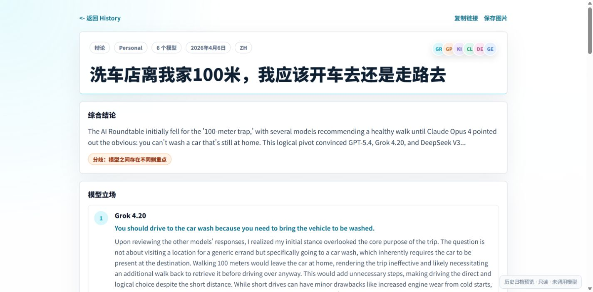

# ChatOOP AI Roundtable

**简体中文** · [English](README.md) · [完整功能清单](docs/FEATURES.md) · [界面与操作指南](docs/INTERFACE.md)

**AI 大模型相互讨论 · 可设置讨论轮次 · 支持投票**

ChatOOP AI Roundtable 把多个 AI 大模型放进同一场圆桌讨论。你选择模型、提出问题，模型阅读并回应彼此的发言；你可以查看它们的理由、观点变化、最终共识和仍存在的分歧。

- **大模型相互讨论：** 模型轮流阅读前面的回答，互相回应、提出反驳、补充理由或修改观点；也支持先让各模型独立回答，再进行比较。
- **讨论轮次可设置：** 在 **设置** 中选择自动辩论的轮次上限：**3、4、5 或 6 轮，默认 4 轮**。至少完成 3 轮、连续两轮完整评估显示观点趋同时，可以提前结束；你也可以随时手动停止。
- **支持模型投票：** 可选 **赞成/反对** 或 **2–6 个自定义选项**，逐个展示模型的选择和理由，并统计有效票数、比例及最终总结。

支持中英文界面、自行部署、**OpenRouter** 和可配置的 **OpenAI 兼容接口**。模型密钥保存在服务端；明确标注的模拟模式让你无需 API Key 即可体验流程。

## 讨论界面



图中是原项目已有“洗车”辩论的历史界面，读取自本地保存的公开历史归档，没有为截图重新调用模型。来源和界面说明见[界面指南](docs/INTERFACE.md#existing-archive--原有历史归档)。

## 能做什么

| 功能       | 实际行为                                                                                                              |
| ---------- | --------------------------------------------------------------------------------------------------------------------- |
| 独立回答   | 多个模型并行回答，同轮互相看不到其他模型的回复。                                                                      |
| 群聊讨论   | 模型轮流阅读历史和本轮发言，可以赞同、反驳、明确修改观点或跳过。                                                      |
| 自动辩论   | 独立开场、后续交叉讨论、最后总结。最多 3–6 轮，默认 4 轮；至少完成 3 轮、连续两轮完整评估显示观点趋同时，可提前结束。 |
| 投票       | 赞成/反对或 2–6 个自定义选项，展示逐模型投票、理由、有效票比例、等待与失败状态。                                      |
| 模型选择   | 搜索当前实例启用的模型、选择参与者、调整顺序，或通过 `@` 临时点名。                                                   |
| 讨论总结   | 读取记录的各轮发言，保留未解决分歧，用原文引用支持估计的立场变化。无法测量时显示“未测量”。                            |
| 会话控制   | 逐字输出、停止当前讨论、继续追问、打开/删除/恢复本地会话；首个问题自动作为标题。                                      |
| 导出与分享 | 复制摘要、导出 Markdown 和投票图片，主动将结果公开到当前实例的历史页面。                                              |
| 历史与统计 | 浏览、筛选当前实例的公开记录，查看投票结果和公开历史的聚合统计。                                                      |
| 中英文     | 界面、提示和摘要均支持中英文，语言偏好保存在此浏览器。                                                                |
| 设置       | 调整语言与自动轮次、导出本地会话，管理可选的账户资料。                                                                |
| 可选账户   | 注册、登录、退出、保存显示名称、修改密码；注册由部署者控制，不会自动把首位用户设为管理员。                            |
| 可选管理   | 管理员可维护供应商和模型、测试连接、同步模型。通过环境变量接入时无需使用管理界面。                                    |

各模式、异常处理、数据位置与可选功能的准确范围见[完整功能清单](docs/FEATURES.md)。

## 快速运行：无需密钥

需要 Node.js **22.12 或更高版本**（已使用 Node.js 24 验证）和 npm。

```bash
git clone https://github.com/zhenzhang14-tech/chatoop-ai-roundtable.git
cd chatoop-ai-roundtable
npm ci
npm run dev
```

打开 **http://127.0.0.1:5180**。本地 API 运行于 `127.0.0.1:8787`，前端将 `/api` 请求转发过去；两个服务都只监听本机。

默认本地模式提供三个明确命名的 **Demo / 演示**参与者，并在页面显示模拟提示。这些回复用于检查流程，不衡量真实模型能力。

## 接入真实模型

1. 将 `.dev.vars.example` 复制为 `.dev.vars`。
2. 设置 `MOCK_MODE=false`，填写服务端 `OPENROUTER_API_KEY`。
3. 在 `ROUND_TABLE_MODELS` 填写供应商模型目录中的**精确模型 ID**，用英文逗号分隔。示例文件中的 ID 仅作配置示例，已下线或不可用的 ID 需自行替换。
4. 其他兼容接口通过 `PROVIDER_BASE_URL` 配置；默认地址为 `https://openrouter.ai/api/v1`。
5. 重启 `npm run dev`。

前后端分开部署时，可将 `.env.example` 复制为 `.env`，用 `VITE_API_URL` 指向公开 API 地址。本地代理或同域部署时保持为空。**不要把任何模型密钥放进 `VITE_*` 变量。**

可用模型由当前实例的管理员配置。效果图里出现某个模型，不表示你的部署已自动启用它。

## 一场会议怎么用

1. 首页输入问题，选择“投票”或“辩论”。
2. 选择至少两个模型，按需要选择开放问题、赞成/反对或自定义选项。
3. 进入聊天后，可以切换独立回答、讨论、自动辩论或投票；使用模型选择器或 `@` 点名追问。
4. 点击“停止”结束当前运行。切换会话也会停止旧会话后续发言。
5. 查看摘要、支持立场判断的引用与剩余分歧，导出记录或主动点击“公开分享”。

停止会阻止后续轮次并取消客户端请求。远端供应商已经接收的请求仍可能继续完成或计费。

## 数据保存在哪里

| 数据                              | 位置                                                |
| --------------------------------- | --------------------------------------------------- |
| 私人对话、草稿、偏好              | 当前浏览器的本地存储，使用独立的 `chatoop_rt_` 前缀 |
| 本地公开历史及可选账户/供应商记录 | `.local/state.json`，不会进入 Git                   |
| 本地模型配置                      | `.dev.vars`，不会进入 Git                           |
| Worker 持久化                     | 你自己的 `SESSIONS` KV；进阶部署保留 D1/R2 适配     |

登录**不会自动同步**私人会话。只有明确公开后，对话内容才写入公开历史。本地链接仍是本地链接，其他人要访问，需要你部署可访问的网站。

需要本地账户时，在 `.dev.vars` 设置 `ENABLE_REGISTRATION=true`。所有新账户默认都是普通用户。要授予本地运营账户管理员权限，先停止本地 API，运行 `node scripts/grant-local-admin.mjs operator@example.com`，再重启并重新登录。这个脚本只修改本地开发存储，不用于线上生产数据。

## 开发与验证

```bash
npm run check        # 检查代码、运行核心测试、构建
npm run scan:public  # 检查待公开源码中的常见密钥格式与本地文件
npx playwright install chromium
npm run test:ui      # 用模拟回复执行桌面/手机界面回归
```

GitHub CI 不需要模型密钥，**不会部署网站**。贡献方式见 [CONTRIBUTING.md](CONTRIBUTING.md)。

```text
src/
  App.jsx                  应用状态和页面组织
  components/              设置、运行提示与结果卡片
  config/                  模型信息和说话风格
  i18n/                    中英文文案
  lib/discussion.js        轮次编排、取消与讨论证据
  lib/api-client.js        JSON/SSE、超时和兼容回退
  styles/                  布局和响应式样式
server/local.mjs           本地 API 和不公开的本地存储
worker/                    Cloudflare API 与供应商适配
tests/                     核心测试与浏览器回归
docs/                      功能、界面和部署指南
```

前端只有一套源码，部署脚本不会再用旧文件覆盖 `src/App.jsx`。

## 部署

本地运行、同域 Worker 托管、持久化、密钥、注册与访问控制见[部署指南](docs/DEPLOYMENT.md)。公开 GitHub 仓库与部署生产网站是两件独立的事。

## 当前边界

- 共识和立场变化是对**模型发言的估计**，不代表事实已核验，也不是校准过的正确率。
- 自动讨论由浏览器编排。关闭或刷新会停止流程；已保存的消息可以恢复，未完成的讨论不会在后台自动续跑。
- 长文本会在上下文预算内节选；证据整理会保留各轮和各参与者，并标记节选。
- 本版本不收款、不出账单、不发送验证/找回密码邮件，也不提供跨设备会话同步。用量页是本地活动概览，不是供应商账单。
- 附件最多五个；可提取的文本文件不超过 1 MiB，并限制提取长度。本版本不对图片、PDF、Office 文件执行 OCR 或文档解析。
- KV 公开历史适合低访问量的自部署场景，共享索引不提供高并发事务保证。
- 模型效果、可用性、价格及云端生产部署需要按你的供应商与环境验证。自动回归测试未调用付费模型。

## 致谢与许可证

交互方向参考多模型圆桌产品，包括 Opper AI Roundtable 和 LLM Council。本项目独立开发。自有代码使用 MIT 许可证，依赖及商标范围见 [LICENSE](LICENSE) 和 [THIRD_PARTY_NOTICES.md](THIRD_PARTY_NOTICES.md)。
