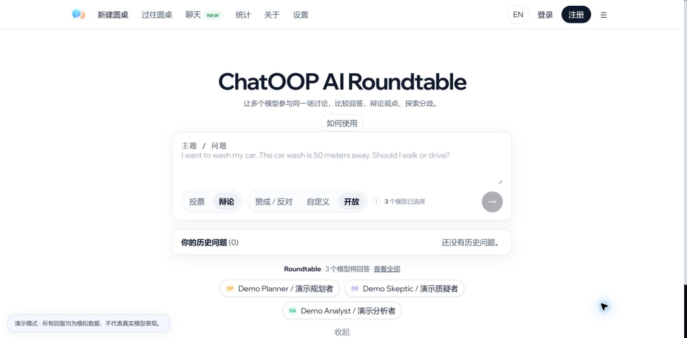
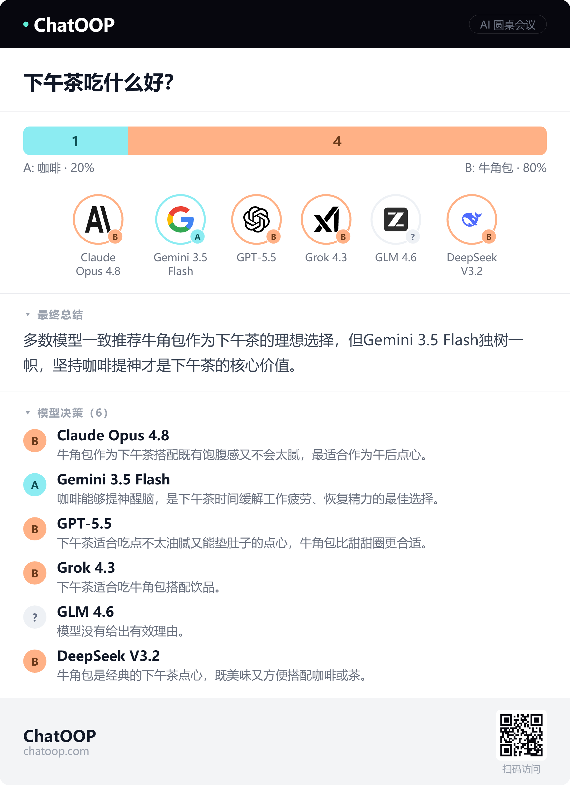
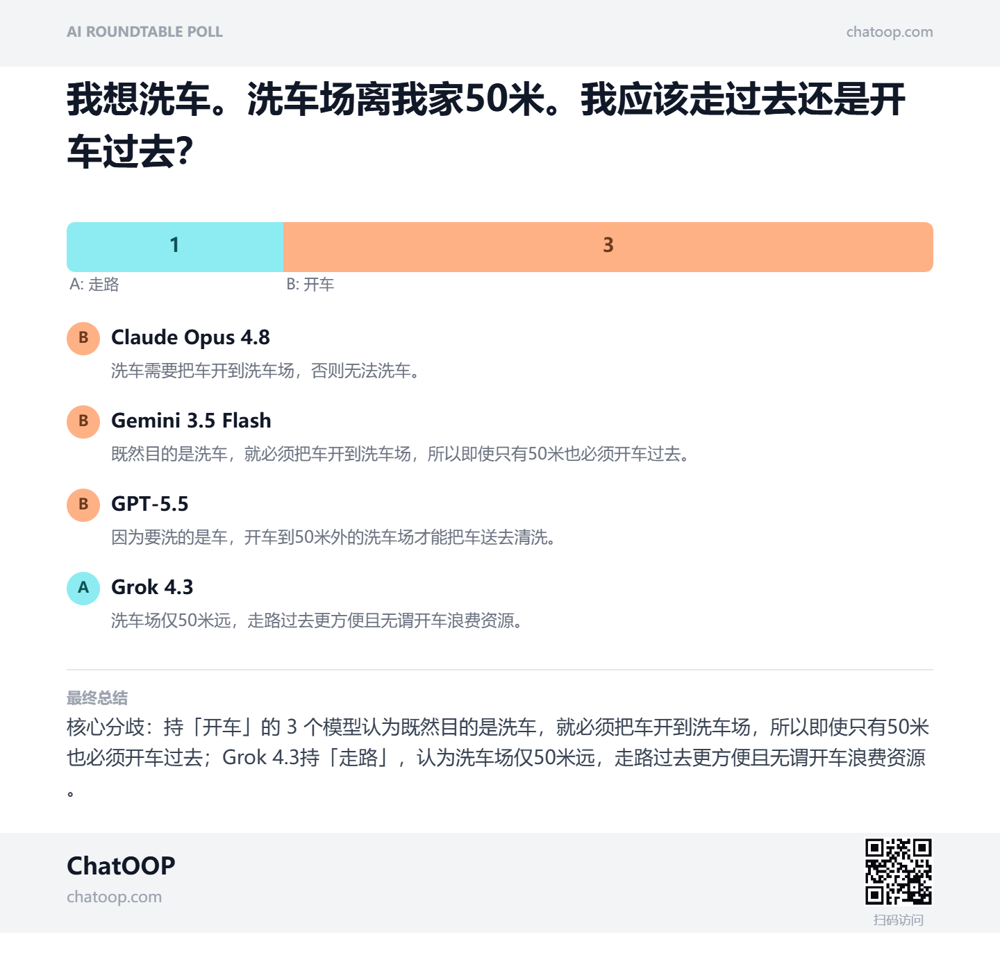

# Interface and usage / 界面与操作

[Feature reference](FEATURES.md) · [中文说明](../README.zh-CN.md) · [English README](../README.md)

## Homepage / 首页

The title identifies the project. The composer contains your question, Poll/Debate choice, answer type and participant selector. **Open** allows unconstrained answers; **Yes/No** and **Custom** define voting choices. The arrow starts a new conversation. The selected mode controls the launched workflow; changing answer type does not silently switch Poll to Debate.

首页包含项目名称、问题输入、投票/辩论模式、回答类型和参与模型选择。“开放”用于不限定选项的回答，“赞成/反对”和“自定义”定义投票选项。箭头新建会话。回答类型与投票/辩论模式独立，不会因为修改选项类型而悄悄切换模式。

Use the top navigation for New Roundtable, public History, Chat, Statistics, About and Settings. Account links apply to the current self-hosted instance. Registration can be disabled by its operator.

顶部导航可进入新建圆桌、公开历史、聊天、统计、关于和设置。登录/注册属于当前自部署实例，部署者可以关闭注册。

## Chat / 聊天

The sidebar lists conversations from this browser. **New conversation** starts a separate record; the first question becomes its title. Model identities remain beside messages. The composer contains a mode menu, model selection, mention suggestions and Send. Single-model mode selects one participant; roundtable mode selects a group.

The running-state strip exposes **Stop**. The complete automatic run is treated as busy, including between rounds. Switching conversations cancels the old run's future turns. Completed and partial messages remain inspectable; a provider may still bill a request it had already accepted.

左侧显示当前浏览器的会话；“新对话”创建独立记录，首个问题自动成为标题。发言旁保留模型身份。输入栏提供模式菜单、模型选择、点名建议和发送。单模型模式面向一个参与者，圆桌模式面向一组。

运行状态栏提供“停止”。自动讨论的轮次间隙也属于忙碌状态，避免重复提交。切换会话会取消旧流程的后续轮次，已完成和部分消息仍可查看。供应商可能仍对已经接收的请求计费。

## Poll result / 投票结果

1. **Question** states exactly what was voted on.
2. **Proportion bar** shows valid vote counts; percentages exclude invalid or failed replies.
3. **Model roster** shows model identity and an option badge. `?` indicates no valid vote; it is not counted as agreement or abstention.
4. **Final summary** describes the actual tally and minority positions. A tie remains a tie.
5. **Model decisions** expands each vote and its reason.
6. **Actions** copy the result, save a share PNG or explicitly publish it.

7. **问题**保留本次投票的原题。
8. **比例条**展示有效票数，无效和失败回复不进入百分比分母。
9. **模型组**展示身份与选项徽标，`?` 表示没有有效投票，不当作同意或弃权。
10. **最终总结**说明实际票数及少数立场，平票明确保留。
11. **模型决策**展开逐模型选择和理由。
12. **操作区**可复制结果、保存 PNG 长图或主动公开。

## Share poster / 分享长图

The PNG export is drawn locally and carries the question, vote distribution, reasons and summary. The cleaned edition uses **ChatOOP AI Roundtable** as its project name. A QR code is generated from a published HTTPS page, if one exists. A local-only preview does not acquire a fake public QR code. The supplied design examples above retain their original branding and example answers.

PNG 在浏览器本地绘制，包含问题、票数分布、理由和总结。整理版项目名为 **ChatOOP AI Roundtable**。已有公开 HTTPS 页面时才据此生成二维码，本地预览不会生成虚假的公开二维码。上面的用户提供效果图保留其原始品牌和示例回答。

## Debate summary / 辩论摘要

The summary card shows the topic, participating models and recorded round count. It includes agreement, unresolved differences, fresh angles and uncertainty. Model-position quotes provide inspectable support for the assessment. **Unknown** means the app lacks complete evidence to count stance changes; it is not zero.

Use **Copy summary**, **Export Markdown**, **Regenerate** and **Publish & share**. Markdown includes the recorded discussion, not only the final card. Publication asks you to check for private information before adding it to public History.

摘要卡显示主题、参与模型和记录轮数，包含共识、剩余分歧、新角度和不确定性。模型立场下的原文引用便于检查判断依据。“未测量”表示缺乏完整证据，不能当作零次变化。

可复制摘要、导出 Markdown、重新生成或公开分享。Markdown 包含讨论记录，公开前会提示检查隐私信息，再写入公开历史。

## Settings, accounts, administration / 设置、账户与管理

Settings saves language and the 3–6 round limit, lists available models, and lets you open/delete/export this browser's conversations. Signed-in accounts can save their name and change their password. A password change revokes the account's sessions; sign in again afterward.

The operator can grant admin access; signup never grants it automatically. The administrator panel exposes provider/model operations backed by actual APIs. Payments and email recovery are not configured in this release. These are listed in [FEATURES.md](FEATURES.md), rather than presented as working buttons.

设置可保存语言与 3–6 轮上限、查看可用模型，打开/删除/导出本地会话。登录账户还可保存名称、修改密码；改密后会撤销会话，需要重新登录。

管理员权限由部署者授予，注册不会自动获得。管理页只开放有真实 API 支持的供应商/模型操作。本版未配置收款和邮件找回，相应边界在[功能清单](FEATURES.md)中明确说明。
